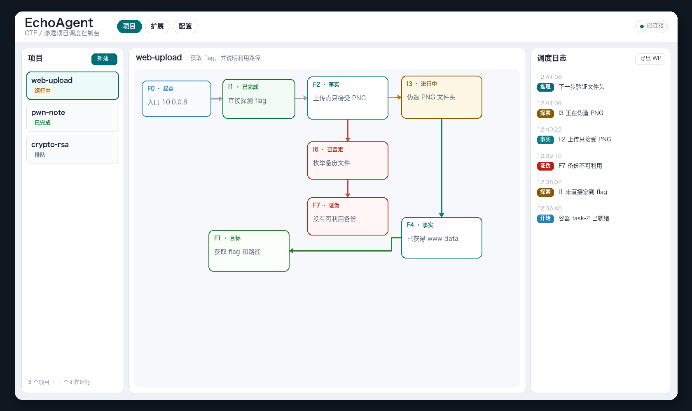

<div align="center">

# EchoAgent

**Codex 在容器里做题，你在图上看它怎么走到答案。**

本地的 CTF / 渗透编排器。事实留下来，意图派出去，每道题一个独立的 Docker 容器。



</div>

一次长会话很容易把侦察留在滚动输出里。超时、退出或者上下文被截断，过程就没了。EchoAgent 把过程拆开：已经证实的写成事实，下一步要验证的写成意图，Codex 只负责在容器里执行。

它是实验性编排器，不保证题目一定被解开。只在你有权操作的题目、靶场或自己的环境里使用。

## 图上只有三样东西

| | 是什么 | 留下来做什么 |
| --- | --- | --- |
| **事实** | 已经记下的证据 | 下次规划不用靠模型回忆 |
| **意图** | 还没做完的下一步 | 做完就有状态，不会当成没做过 |
| **容器** | 这道题自己的 Kali 环境 | 附件、工具和失败输出不跟别的题混 |

起点和目标先在图上。中间长出来的，就是这次任务真正走过的路。

## 三拍往前走

1. **先试一次。** 直接碰目标。打通了就收束；没打通，就把侦察落成事实。
2. **再分头验证。** 每条未完成的意图交给容器里的 Codex，多条可以同时跑。
3. **然后决定下一步。** 没有待执行的意图时，只根据已有事实规划，避免在同一个想法里空转。

控制台同时看着项目状态、事实图、调度日志和 Token 用量。完成后可以导出解题报告。

## 快速开始

需要 Python 3.11+、Docker，以及 worker 镜像里可用的 Codex CLI。

```bash
python -m pip install -r requirements.txt
cp echo_agent.toml.example echo_agent.toml
python -m echo_agent server --host 127.0.0.1 --port 8000 --db .echo_agent/echo_agent.db
```

打开 [http://127.0.0.1:8000/](http://127.0.0.1:8000/) ，新建项目，写上目的，然后启动。

可编辑安装：

```bash
python -m pip install -e .
```

也可以直接运行 FastAPI：

```bash
uvicorn echo_agent.server.main:app --host 127.0.0.1 --port 8000
```

## 能直接用到的

- 本地控制台：建题、看图、看日志、停止，以及调整调度和 Codex。
- URL、IP、附件和 Hint 可以组合。
- 密码题单独走 crypto 项目，可上传离线输入。
- 扩展页管理工具、知识库和技能，启动时挂进容器。
- 多个项目可以排队或同时运行，容器互不混用。
- 模型、供应商、重试和超时都可以换。

## 命令行

创建并激活：

```bash
python -m echo_agent dispatcher create-project \
  --target-url https://target.example \
  --hint "可选提示" \
  --objective "获取 flag" \
  --activate
```

走一步，或按间隔循环：

```bash
python -m echo_agent dispatcher run-once 1 --max-workers 4
python -m echo_agent dispatcher run-loop 1 --interval 3 --max-steps 10 --max-workers 4
```

## 配置

从当前目录读取 `echo_agent.toml`，也可以换文件：

```bash
export ECHO_AGENT_CONFIG=/path/to/echo_agent.toml
```

优先级：

```text
环境变量 > .echo_agent/console_settings.toml > echo_agent.toml > echo_agent.toml.example
```

| 配置段 | 作用 |
| --- | --- |
| `[server]` | 控制台地址、端口和数据库路径 |
| `[dispatcher]` | 循环间隔、每个项目的 Codex 槽位、可同时运行的项目数 |
| `[codex]` | 容器内命令、模型、供应商、重试和超时 |
| `[docker]` | worker 镜像的构建和运行 |
| `[resources]` | 扩展文件在宿主机上的根目录 |

本机配置写在 `echo_agent.toml`。这个文件已被忽略，不要提交密钥。可分享的模板是 `echo_agent.toml.example`。

## 扩展

工具、知识库和技能在控制台的扩展页维护。清单在 `extensions.json`，文件下载到 `[resources].root`。

首次启动会准备这些位置：

- 加入 `PATH` 的工具：katana、nuclei、dalfox、cloudfox，挂到 `/home/kali/.local/bin`。
- `ysoserial` 位于 `/home/kali/tools/ysoserial.jar`。
- `nuclei-templates` 位于 `/home/kali/.local/nuclei-templates`。
- 共享目录：`/home/kali/tools`、`/home/kali/knowledges`、`/home/kali/pocs`；技能位于 `/home/kali/.agents/skills`。

启动时下载缺失文件，项目运行前再检查一次，失败就停。扩展页的「更新」会按当前 URL 重新下载并替换。增删只在扩展页做，不要在 `echo_agent.toml` 里再维护一份清单。`items` 保持为空。

## 容器

每个项目一个容器，名称通常是 `echo-agent-task-<project_id>`。

| 项目状态 | 容器 |
| --- | --- |
| `active` | 创建或启动，并准备挂载 |
| `running` | 调用 Codex 前确保容器在运行 |
| `stoped` | 停止容器 |
| `completed` | 删除容器 |

在界面里停止时会执行：

```bash
docker stop -t 0 <container>
```

## 测试

```bash
python -m unittest
node --check echo_agent/server/static/app.js
```

## 致谢

受到 [oritera/Cairn](https://github.com/oritera/Cairn) 的启发，借用了用图表示任务推进的想法。EchoAgent 是独立实现，重点放在 Docker 隔离的 Codex worker、本地控制台，以及可配置的共享安全资源。
